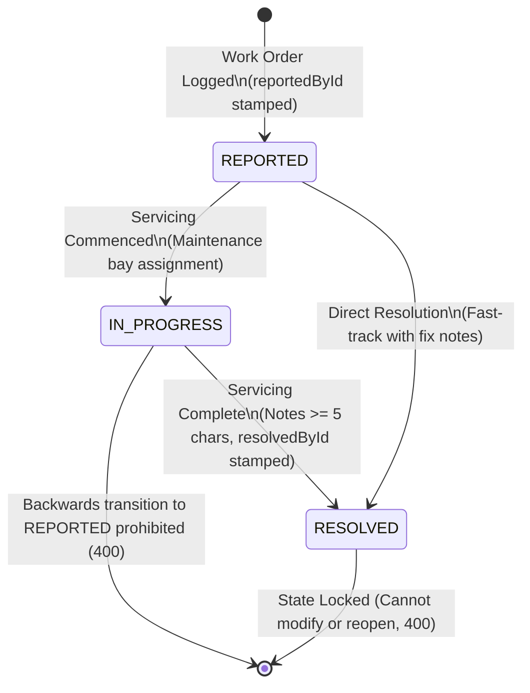

# BTS Fleet Maintenance Workflow & Dispatch Restrictions

---

## 1. Overview & Fleet Safety Policy

The BTS Fleet Maintenance subsystem ensures that vehicles requiring servicing, inspection, or repairs cannot be scheduled or dispatched into passenger service. The system guarantees that maintenance workflows are tracked with end-to-end accountability, linear lifecycle transitions, and strict backend-enforced dispatch locks.

---

## 2. Work Order Classification

All maintenance issues are classified into canonical categories:

| Category | Description & Common Triggers |
| :--- | :--- |
| `ENGINE` | Powertrain faults, overheating, oil pressure anomalies, transmission issues. |
| `TIRES` | Tread wear below safety thresholds, puncture, alignment, inflation failures. |
| `ELECTRICAL` | Headlight/taillight cluster failure, alternator faults, battery depletion, wiring damage. |
| `GENERAL` | Air conditioning, passenger seat anchoring, door hydraulics, windshield damage. |

---

## 3. Linear State Transition Rules

Work orders strictly enforce forward-only progression to prevent inconsistent ticket states:



### Transition Validation Rules
1. **Creation**:
   - Initial status is always `MaintenanceStatus.REPORTED`.
   - `reportedById` is atomically bound to the initiating administrator's ID.
   - Logs `MAINTENANCE_CREATED` in `AdminAudit`.
2. **Progression**:
   - $\text{REPORTED} \to \text{IN\_PROGRESS}$ is permitted.
   - $\text{IN\_PROGRESS} \to \text{RESOLVED}$ is permitted.
   - Direct $\text{REPORTED} \to \text{RESOLVED}$ is permitted when an immediate fix is recorded.
   - Reverting $\text{IN\_PROGRESS} \to \text{REPORTED}$ is strictly prohibited and throws `400 BadRequestException`.
3. **Resolution Lock**:
   - Transitioning to `RESOLVED` requires non-empty resolution notes ($\ge 5$ characters). Submissions with missing or brief notes are rejected with `400 BadRequestException`.
   - Atomically records `resolvedAt: now()` and `resolvedById: adminId`.
   - Modifying an already `RESOLVED` ticket throws `400 BadRequestException`. Re-opening requires creating a new tracked work order.
   - Logs `MAINTENANCE_RESOLVED` in `AdminAudit`.

---

## 4. Backend Dispatch Integrity Hardening

To prevent unsafe vehicles from operating, dispatch blocking is enforced at the database transaction layer within `AssignmentIntegrityService.assertBusAvailable`:

### Vehicle Status Guard
Vehicles marked with `status === 'MAINTENANCE'` or `isActive === false` are rejected from trip assignment with `400 BadRequestException`.

### Active Work Order Guard
Even if a bus record has `status === 'ACTIVE'`, the system inspects open maintenance tickets:

```typescript
const activeTicket = await prisma.busMaintenance.findFirst({
  where: {
    busId,
    status: { in: ['REPORTED', 'IN_PROGRESS'] },
  },
});
```

If an open ticket exists, dispatch is rejected inside the atomic transaction with:
> `"Bus ${bus.plateNumber} cannot be dispatched: active maintenance work order in progress (${activeTicket.category}: ${activeTicket.description})"`

This prevents front-end bypasses and ensures zero un-inspected vehicles can enter service.

---

## 5. Authorized Release to Service Protocol

Returning a repaired bus to service requires explicit authorization:

### Release Workflow (`POST /admin/buses/:id/release`)
1. **Unresolved Ticket Verification**: The system verifies that zero tickets with status `REPORTED` or `IN_PROGRESS` exist for the bus. If any open ticket remains, the release request is rejected with `400 BadRequestException ("Cannot release bus: active maintenance work orders remain unresolved")`.
2. **Reactivation**: Once all tickets are confirmed `RESOLVED`, the bus record is updated atomically:
   - `status = BusStatus.ACTIVE`
   - `isActive = true`
3. **Audit Logging**: Emits `BUS_RELEASED_TO_SERVICE` in `AdminAudit` recording the authorizing administrator, bus ID, plate number, and status transition.
