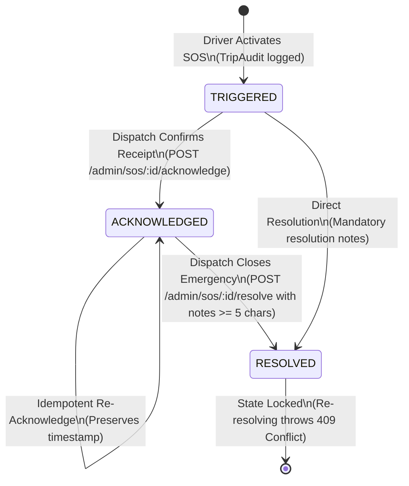

# BTS Safety & Distress Escalation Protocol (SOS Lifecycle)

---

## 1. Overview & Operational Objectives

The Emergency SOS distress protocol in the BTS College Bus Tracking System provides a rapid, authenticated, and isolated mechanism for drivers to signal life-safety or mechanical distress during transit. The pipeline ensures zero distress signal leakage to unauthorized parties while providing dispatchers with actionable, unforgeable telemetry.

---

## 2. Distress Signal Trigger & Ingestion

### Driver Interface Trigger
- **Hold-to-Confirm Activation**: To prevent accidental touches while navigating campus traffic, the driver interface requires an uninterrupted **3-second hold** before triggering the distress payload.
- **Payload Composition**:
  - `tripId`: Authoritative active trip identifier.
  - `driverId`: Authenticated driver identifier bound to the active session.
  - `reason`: Standardized or freeform distress classification (e.g., `ACCIDENT`, `BREAKDOWN`, `MEDICAL`, `SECURITY`).
  - `lastKnownGps`: Coordinate fix snapshot (`latitude`, `longitude`, `speed`, `heading`, `accuracy`, and `timestamp`).

### Telemetry & Velocity Capture
The distress ingestion handler atomically samples the vehicle's latest valid GPS fix:
- If current tracker fix is available ($\le 30\,\text{s}$ old), the exact reported latitude, longitude, and ground velocity are embedded directly into the alert evidence.
- If tracker is stale, the last recorded location history entry is attached with timestamp age metrics.
- Dead-reckoned drift or interpolated coordinates are strictly prohibited from emergency records.

---

## 3. Realtime Isolation & Admin Broadcast Routing

Distress events demand strict operational containment to prevent passenger panic:

```
[Driver App: SOS Trigger]
          │
          ▼
[POST /trips/:id/sos]
          │
          ├──────────────────────────────────────────────────────┐
          ▼                                                      ▼
[Prisma: TripAudit (action=SOS)]                        [TripsGateway]
                                                                 │
                                                       (admin room ONLY)
                                                                 │
                                                                 ▼
                                                  [Dispatch / Admin Monitor]
                                            (Students & unassigned Drivers EXCLUDED)
```

- **Isolated Admin Channel**: Alerts are broadcast strictly to the isolated WebSocket room `admin` using the event tag `admin:sos`.
- **Zero Student Leakage**: Student channels (`user:${studentId}`, `trip:${tripId}`) are strictly isolated from `admin:sos` events.
- **Zero Peer Driver Leakage**: Other drivers on concurrent trips do not receive emergency distress broadcasts unless specifically designated as emergency responders by administrative dispatch.

---

## 4. Lifecycle State Machine & Idempotency Locks

Distress alerts progress through a three-stage lifecycle governed by state locks:



### State Lock Rules
1. **Idempotent Acknowledgment**:
   - Calling `POST /admin/sos/:id/acknowledge` records `acknowledgedAt: now()` and `acknowledgedBy: adminId`.
   - Repeated acknowledgment calls return cleanly without re-writing timestamps or emitting duplicate audit entries.
2. **Resolution State Lock**:
   - Resolving an already `RESOLVED` alert throws `409 ConflictException`, preventing tampering or overwritten resolution histories.
   - Calling acknowledge after an alert is already resolved returns cleanly as an idempotent no-op without altering the `resolvedAt` timestamp.

---

## 5. Mandatory Resolution Accountability & Notes Validation

To ensure accountability, closing an emergency alert enforces strict input validation:
- **Minimum Length**: The `resolutionNotes` field must be non-empty and at least **5 characters** in length after trimming.
- **Rejection**: Blank submissions, whitespace-only strings, or truncated descriptions (e.g. `"ok"`, `"done"`) are rejected with `400 BadRequestException`.
- **Atomic Stamp**: On successful resolution, the record atomically records `resolvedAt: now()` and `resolutionNotes`.
- **Audit Logging**: An immutable entry `SOS_RESOLVED` is logged to `AdminAudit` capturing resolver identity, target ID, and resolution summary.

---

## 6. Immutable Evidence Preservation

Distress records stored in `TripAudit` serve as legal and forensic evidence:
- **Preserved Attributes**: Original `tripId`, `driverId`, `action: 'SOS'`, and the complete `metadata` JSON (including initial GPS coordinates, speed, and distress reason) are immutable.
- **Prohibited Operations**: No REST endpoints support `DELETE`, `PUT`, or arbitrary `PATCH` updates against `TripAudit`.
- **Resolution Linkage**: Resolution metadata updates add resolution state columns without mutating the historical event payload.
